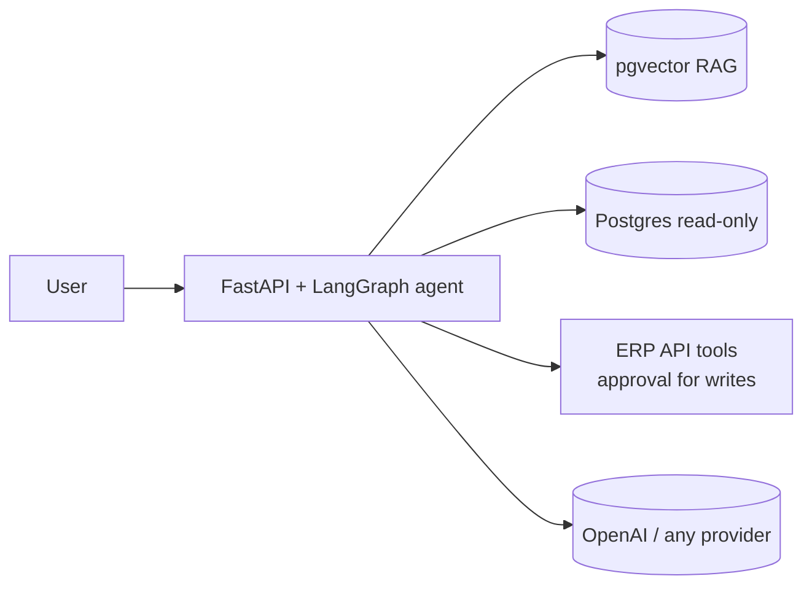

# FDE Engagement Kit

**A reusable kit for delivering enterprise GenAI agents the way a Forward Deployed Engineer does: discover the problem, connect the customer's documents, data and APIs, ship an evaluated agent, deploy it, and hand it over.**

> Status: 🚧 1-week build sprint started 2026-11-09. See [schedule](docs/04-wbs-and-schedule.md).

---

## The problem (engagement #1)
Northwind Logistics (fictional) spends 10–20 minutes per late-shipment inquiry jumping between a legacy ERP, a reporting database, and ~20 policy PDFs, and gets SLA credits wrong. → [Discovery](engagements/demo-logistics/discovery.md)

## The solution
One AI agent that can:
- **Search policies** with cited answers (RAG over pgvector, hybrid search)
- **Query operational data** safely (read-only SQL tool)
- **Act in the ERP** through tools generated from its OpenAPI spec, with **human approval** before any write

…and a kit that lets the same core serve **any similar customer** by adding one config folder.



## Proof points
| Claim | Evidence |
|---|---|
| Works | `.\tasks.ps1 demo` → local stack in ≤ 15 min |
| Measured | Golden-set evals gate CI (≥ 85%, safety 100%) → [strategy](docs/09-test-and-eval-strategy.md) |
| Safe | Read-only SQL, approval gates, PII redaction, injection filter → [threat model](docs/10-security-and-compliance.md) |
| Deployed | Terraform → GCP Cloud Run + Cloud SQL; Helm on Kubernetes (kind) → [runbook](docs/11-deployment-runbook.md) |
| Reusable | Engagement #2 built with **zero** core code changes |
| Delivered like a real project | Charter, scope, risks, ADRs, closure → [docs index](docs/README.md) |

## Tech stack
Python 3.12 · FastAPI · LangChain · LangGraph · OpenAI (switchable: Anthropic, Azure OpenAI, Bedrock, Vertex) · PostgreSQL + pgvector (FAISS/Chroma adapters) · Docker · Kubernetes/Helm · GitHub Actions · Terraform · GCP Cloud Run · OpenTelemetry · Streamlit

## Quick start (PowerShell)
```powershell
git clone <repo>; Set-Location fde-engagement-kit
Copy-Item .env.example .env          # add OPENAI_API_KEY or set FAKE_LLM=1
.\tasks.ps1 demo -Engagement demo-logistics
```

## New customer? Use the playbook
```powershell
Copy-Item -Recurse engagements\_template engagements\acme
# discovery → access checklist → engagement.yaml → golden set → .\tasks.ps1 ingest → .\tasks.ps1 eval
```
→ [Engagement Playbook](playbook/README.md)

## Repository map
| Path | Contents |
|---|---|
| `core/` | Generic platform: config, connectors, ingest, retrieval, toolgen, agent, guardrails, evals, API |
| `engagements/` | One folder per customer situation |
| `services/mock-erp/` | Simulated enterprise system |
| `deploy/` | Docker, Helm, Terraform, SQL |
| `playbook/` | Repeatable FDE delivery method |
| `docs/` | Project & technical documentation |

## Author
E. Mkwambe — built as a skills-development and portfolio project. All data is synthetic.
