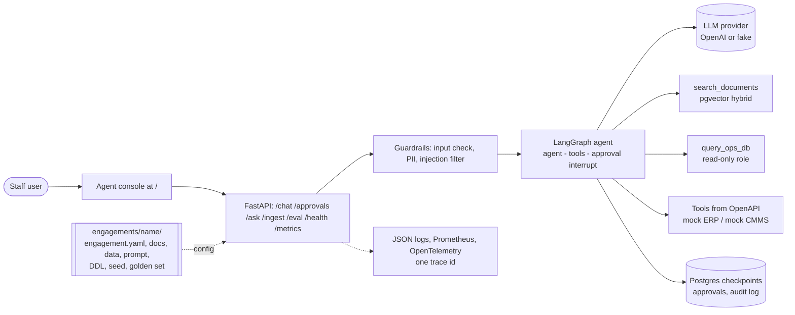

# FDE Engagement Kit

A reusable kit for delivering enterprise GenAI agents the way a Forward Deployed Engineer does: understand the customer's
problem, connect their documents, database and APIs, ship an agent that is measured by evals, deploy it, and hand it over.
A new customer is a new folder under `engagements/`, with no changes to `core/`.

Status (2026-11-11, end of Sprint 01): two engagements run on one core; CI is green; the real-model eval of engagement #1
is incomplete because of the provider's daily request quota; the cloud deployment is prepared but not applied.
Details and evidence: [sprint report](docs/sprints/reports/sprint-01-report.md), [closure report](docs/15-closure-report.md).

## What the agent does

| Ability | How | Safety |
|---|---|---|
| Answer policy questions with citations | RAG over pgvector, hybrid search (vector + full text, RRF) | "I don't know" below a similarity threshold; injection filter on retrieved text |
| Look up operational data | One read-only SQL tool over the engagement's schema | SELECT-only validation, row limit, read-only database role, 5 s timeout |
| Act in the customer's systems | Tools generated from their OpenAPI spec | Every write pauses for a human; approvals are atomic and audited |
| Refuse attacks | Regex guardrails on input and on every tool result | PII redaction (email, phone, SSN); attempts are logged |

## The two engagements (both fictional)

| | #1 Northwind Logistics | #2 Coastline Climate Services |
|---|---|---|
| Problem | Late-shipment inquiries and SLA credits | HVAC dispatch: response-time SLAs, credits, on-call dispatch |
| Systems | 20 policy docs, `ops` schema, mock ERP (shipments, tickets) | 11 policy docs, `field` schema, mock CMMS (work orders, dispatches) |
| Write that needs approval | `createTicket` (credit ticket) | `createDispatch` (send a technician) |
| Folder | [engagements/demo-logistics](engagements/demo-logistics/) | [engagements/coastline-hvac](engagements/coastline-hvac/) |
| Real-model eval | gpt-6-luna, prompt agent-v1: 18/18 finished cases pass, 9 not run (quota) -> [latest report](engagements/demo-logistics/evals/reports/2026-11-11-0811-gpt-6-luna-cadb61d.md) | Not run yet (quota) |
| Zero-core-change proof | - | `git diff --stat kit-generic..e69d0b6 -- core/` is empty: e69d0b6 is the commit that added engagement #2 ([note 21](docs/teaching/21-second-engagement.md)). Later core commits are generic review fixes (DC-031) |

## Architecture



More: [architecture](docs/05-architecture.md) · [security](docs/10-security-and-compliance.md) · [runbook](docs/11-deployment-runbook.md).

## Quick start (PowerShell 7 and Docker Desktop; CI runs the same steps, image builds included, in about 3 minutes)

```powershell
git clone https://github.com/emkwambe/fde-engagement-kit.git
Set-Location fde-engagement-kit
Copy-Item .env.example .env                       # FAKE_LLM=1: no API key and no cost
.\tasks.ps1 demo                                  # builds images, starts postgres, seed, migrate+ingest, mock ERP, API
Invoke-RestMethod http://localhost:8000/health    # status ok, version.build_sha = your commit
Start-Process http://localhost:8000               # the agent console: ask, see citations, approve or reject writes
.\tasks.ps1 stack-down
```

Development without containers (needs [uv](https://docs.astral.sh/uv/)):

```powershell
.\tasks.ps1 setup; .\tasks.ps1 up; .\tasks.ps1 migrate; .\tasks.ps1 seed; .\tasks.ps1 ingest
.\tasks.ps1 erp                                   # second window: mock ERP on port 8100
.\tasks.ps1 api                                   # third window: API + console on port 8000
uv run pytest -q; .\tasks.ps1 lint; .\tasks.ps1 eval
```

Engagement #2: add `-Engagement coastline-hvac` to `migrate`, `seed`, `ingest`, `eval`, run `.\tasks.ps1 cmms` (port 8200)
instead of `erp`, and start the API with `$env:ENGAGEMENT = 'coastline-hvac'`.

## A new customer

```powershell
Copy-Item -Recurse engagements\_template engagements\acme
# discovery.md -> documents -> sql/ + table specs -> engagement.yaml -> golden set -> migrate, seed, ingest -> eval
```

The template documents every setting. [Playbook](playbook/README.md) · [Note 21: how engagement #2 was onboarded](docs/teaching/21-second-engagement.md).

## Learn how it works: teaching notes

Every component has a lesson note with an ELI10 explanation and hands-on practicums whose results are real output:
[series index](docs/teaching/README.md). Start with [12 - the agent graph](docs/teaching/12-agent-graph.md),
[15 - measuring quality](docs/teaching/15-measuring-quality.md) and [21 - a new customer is a new folder](docs/teaching/21-second-engagement.md).

## Repository map

| Path | Contents |
|---|---|
| `core/` | Generic platform: config, ingest/ETL, retrieval, RAG, toolgen, agent, guardrails, evals, observability, API |
| `engagements/` | One folder per customer: config, discovery, documents, DDL, seed script, prompt, fake script, golden set, eval reports |
| `services/` | Mock customer systems: `mock-erp` (engagement #1), `mock-cmms` (engagement #2) |
| `deploy/` | Dockerfiles, Helm chart, Terraform for GCP, SQL migrations |
| `.github/workflows/` | CI, manual real-model eval, manual (disabled) deploy |
| `docs/` | Project and technical documentation, decision log, teaching notes, sprint reports |

## Tech stack

Python 3.12, uv, FastAPI, Pydantic v2, LangChain core, LangGraph, OpenAI (provider switch by config), PostgreSQL 16 +
pgvector, psycopg 3, OpenTelemetry, Prometheus client, Docker, Helm, kind, GitHub Actions, Terraform, GCP Cloud Run.

## Author

E. Mkwambe. A skills-development and portfolio project. All companies, people and data are synthetic.
