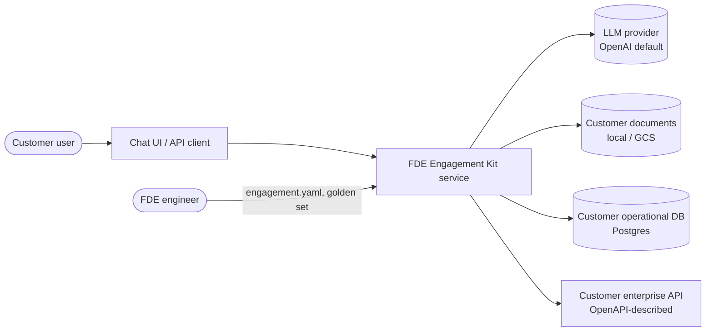
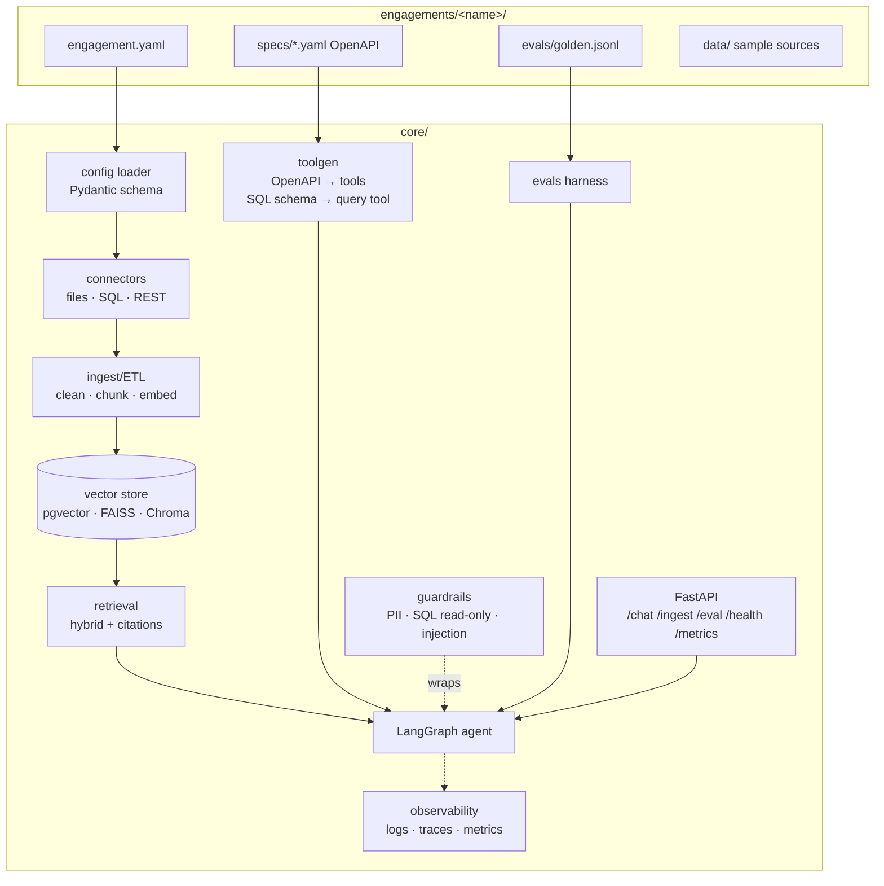
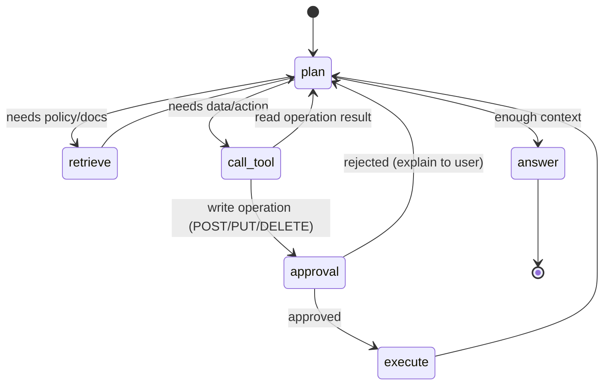
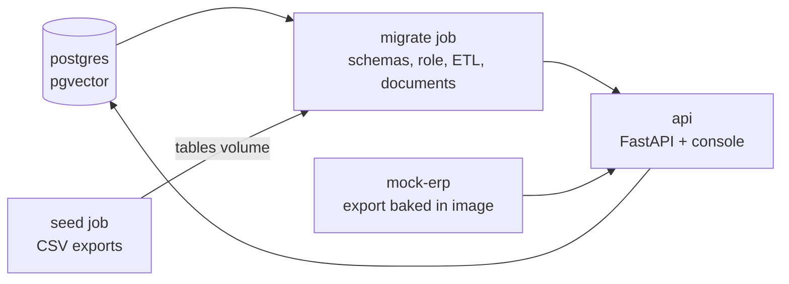
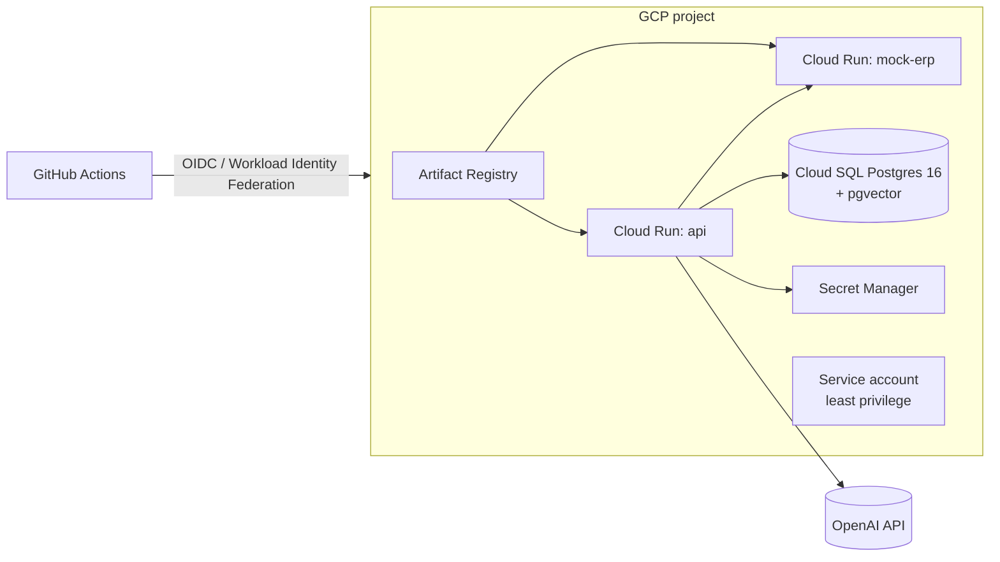

# Solution Architecture

Parent: [Requirements](02-requirements.md) · Decisions: [ADRs](adr/)

## 1. Context



## 2. Logical architecture



## 3. Agent graph (LangGraph)



- **State:** messages, retrieved chunks (with ids), pending tool call, approvals, step count.
- **Checkpointer:** Postgres (same database, separate schema) so paused runs survive restarts.
- **Loop guard:** max 8 steps per turn; on overflow, answer with what is known and say so.
- **Answer contract:** structured output `{answer, citations[], actions_taken[], confidence}`.

## 4. Key data flows

### 4.1 Ingestion
1. Connector lists sources from config.
2. Extract text (PDF/DOCX/HTML/MD) → normalize → split (default 800 tokens, 100 overlap; configurable).
3. Content hash per chunk → skip unchanged (idempotent).
4. Embed in batches → upsert into `chunks(id, doc_id, section, text, embedding vector, tsv tsvector, metadata jsonb, hash)`.
5. HNSW index on `embedding`, GIN index on `tsv`.

### 4.2 Question → answer
1. `/chat` receives message + thread id → guardrails (input checks) → agent.
2. Agent plans; tools are retrieval, SQL query, generated API tools.
3. Retrieved text passes the injection filter before reaching the model.
4. Tool outputs pass PII redaction (configurable) before reaching the model and logs.
5. Write actions pause for approval; UI shows the pending action.
6. Final structured answer with citations returned; trace id in response headers.

## 5. Deployment views

### 5.1 Local (Docker Compose) - as built in Sprint 01 (DC-018)



The console is served by the API at `/` (DC-014, DC-017: it replaces the planned Streamlit container). Traces go to the
console (stdout) by default; set `OTEL_TRACES_EXPORTER=otlp` and `OTEL_EXPORTER_OTLP_ENDPOINT` to send them to a collector.

### 5.2 Kubernetes (kind) via Helm - `deploy/helm/fde-kit`
Deployments: `fde-api` (init containers `seed`, `migrate`), `fde-mock-erp` · StatefulSet: `fde-postgres` (kind only) ·
ConfigMap: engagement.yaml (`--set-file engagementConfig`) · Secret: tokens and passwords (or `existingSecret`) ·
Probes: `/health` · non-root, read-only root filesystem. Installed on kind in every CI run.

### 5.3 GCP (Terraform)



### 5.4 Observability (DC-017)

One request = one OpenTelemetry trace: `HTTP` span (middleware) -> `agent.run` -> `agent.step agent|tools|approval` ->
`llm.call` / `tool <name>`. The trace id is returned as `X-Trace-Id` and stored in `agent.audit_log.trace_id`.
`GET /metrics` exposes request, model-call, token, tool-call, approval and guardrail counters for Prometheus. Each request
writes one JSON log line with counts and tool names only.

## 6. Technology choices (summary)

| Concern | Choice | Alternatives considered | ADR |
|---|---|---|---|
| Agent framework | LangGraph | Plain LangChain agents, custom loop, LlamaIndex workflows | [ADR-001](adr/ADR-001-langgraph.md) |
| Vector store | pgvector | Pinecone, Weaviate, Chroma, FAISS | [ADR-002](adr/ADR-002-pgvector.md) |
| Cloud runtime | GCP Cloud Run | GKE, AWS ECS/App Runner, Azure Container Apps | [ADR-003](adr/ADR-003-cloud-run.md) |
| Customization model | Config-driven engagements | Fork per customer, plugin code per customer | [ADR-004](adr/ADR-004-config-driven-engagements.md) |
| LLM provider | OpenAI default behind abstraction | Single-vendor SDK calls | [ADR-005](adr/ADR-005-llm-provider-abstraction.md) |
| API framework | FastAPI | Flask, Django | — |
| Packaging | uv + pyproject | pip/poetry | — |

## 7. Cloud portability map

| Capability | GCP (built) | AWS (equivalent) | Azure (equivalent) |
|---|---|---|---|
| Container runtime | Cloud Run | App Runner / ECS Fargate | Container Apps |
| Managed Postgres + pgvector | Cloud SQL / AlloyDB | RDS / Aurora PostgreSQL | Azure Database for PostgreSQL Flexible Server |
| Container registry | Artifact Registry | ECR | ACR |
| Secrets | Secret Manager | Secrets Manager | Key Vault |
| Object storage (docs) | GCS | S3 | Blob Storage |
| Managed LLM | Vertex AI | Bedrock | Azure OpenAI |
| CI identity | Workload Identity Federation | IAM OIDC provider | Federated credentials (Entra ID) |
| Kubernetes | GKE | EKS | AKS |

What changes for a new cloud: Terraform module, object-store connector config, LLM provider config. What doesn't: core code, container image, Helm chart, evals.

## 8. Kit and engagement boundary (Sprint 01, DC-019..DC-029)

| Concern | Kit (`core/`, same for every customer) | Engagement (`engagements/<name>/`) |
|---|---|---|
| Tables | ETL engine, column-type cleaners, FK checks | DDL (`sql/`), table specs and cleaning rules (YAML) |
| Synthetic data | `core.ingest.seed` runner | `extensions/seed.py` (`generate(out_dir)`) |
| Agent | LangGraph graph, approval interrupt, generic prompt | `prompts/agent-vN.txt` + `prompt_version` |
| Offline testing | `ScriptedFake`, `GenericFakeChat` | `extensions/fake_agent.py` (`FakeAgent`) |
| Tools | OpenAPI tool generator, read-only SQL tool | OpenAPI spec, operations to include, schema name |
| Guardrails | PII and injection filters | which PII kinds, refusal wording |
| Evals | runner, six checks, gate | golden set, threshold |
| Console | page, `GET /engagement` | example questions |

## 9. Repository layout

```
fde-engagement-kit/
├── core/                 # generic platform (never customer-specific)
│   ├── config/  connectors/  ingest/  retrieval/  toolgen/
│   ├── agent/   guardrails/  evals/   api/  observability/
├── engagements/
│   ├── _template/        # copy for each new customer
│   ├── demo-logistics/   # engagement #1 (Northwind Logistics, fictional)
│   └── coastline-hvac/   # engagement #2 (Coastline Climate Services, fictional)
├── services/             # simulated customer systems: mock-erp (#1), mock-cmms (#2)
├── ui/                   # one-file agent console, served by the API at /
├── deploy/
│   ├── docker/  helm/  terraform/gcp/  sql/
├── .github/workflows/
├── playbook/             # repeatable FDE method
├── docs/                 # this documentation set
├── tests/
├── tasks.ps1             # PowerShell task runner (replaces make)
└── README.md
```
