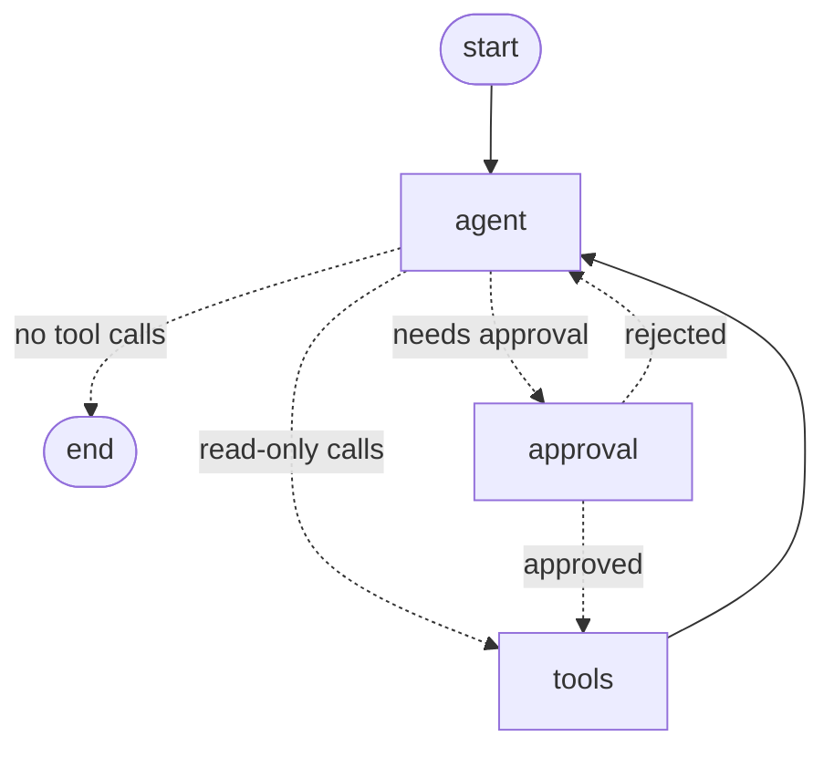

# 12 - The agent graph

Component: `core/agent/graph.py`, `core/agent/doc_tool.py`, `core/agent/fake.py`, `core/agent/checkpoint.py`, `scripts/ask_agent.py`, `scripts/show_graph.py`, `tests/day02/test_agent.py`

<!-- Color key: NOTE (blue) = INTENT/Why, IMPORTANT (purple) = CONTEXT/When-Where, TIP (green) = ACTION/How, WARNING (yellow) = RESULT/What, CAUTION (red) = RESULT of a break-it practicum -->

## At a glance

| What | When | How | Why |
|---|---|---|---|
| A LangGraph state machine that lets the LLM choose tools, loops until it can answer, and pauses before any write | Every question that needs more than one source: documents, database and live systems | Three nodes (agent, tools, approval); conditional routing; interrupt() for approval; a Postgres checkpointer saves every step per thread | The model plans, the graph enforces the rules: bounded steps, human approval for writes, conversations that survive restarts |

## ELI10

Think of a **board game** played by a clever but new player (the LLM) and a strict **referee** (the graph).

- On each turn the player looks at the board (the conversation) and says either "I'm done, here's my answer" or "I want to use these cards" (tools: search the rule book, ask the database, call the ERP).
- The referee checks the card. Reading cards are played at once. **Red cards** (anything that changes something, like creating a credit ticket) can only be played after a **grown-up says yes**. The game is frozen until they decide.
- After every move the referee **takes a photo of the board** (a checkpoint) and files it under the game's name (the thread id). If the lights go out, everyone comes back, finds the photo, and continues from the exact same spot, even the next day.
- There's a **turn limit**, so the player can never loop forever.

Where the analogy stops: a referee in a real game knows every rule. Ours only enforces the structural rules (approval, step limit, valid arguments). Whether the player made a *smart* move, like picking the right policy or doing the math right, is measured separately with evals on Day 3.

## The graph

`scripts/show_graph.py` prints this. GitHub draws it:



## Practicums

Color key: blue = **INTENT (Why?)**, purple = **CONTEXT (When / where?)**, green = **ACTION (How?)**, yellow = **RESULT (What?)**.

Before you start: Postgres up (`.\tasks.ps1 up`), mock ERP running in a second window (`.\tasks.ps1 erp`), and `FAKE_LLM=1` in `.env`. The fake model follows a fixed script, so you get exactly these results. With `FAKE_LLM=0`, OpenAI chooses the tools itself, and the wording will differ.

### Practicum 1

> [!NOTE]
> **INTENT - Why?** "What does the agent look like, and which tools does it have?"

> [!IMPORTANT]
> **CONTEXT - When / where?** The graph is built from engagement.yaml: search_documents plus the 5 generated tools from note 11.

> [!TIP]
> **ACTION - How?**
>
> ```powershell
> uv run python scripts/show_graph.py
> ```

> [!WARNING]
> **RESULT - What happened, and what does it mean?**
>
> ```text
> graph TD;
>   __start__ --> agent;
>   agent -.-> __end__;
>   agent -.-> approval;
>   agent -.-> tools;
>   approval -.-> agent;
>   approval -.-> tools;
>   tools --> agent;
> tools (6): search_documents, query_ops_db, getShipment, listShipments, createTicket, getTicket
> Dotted arrows are decisions made at run time (routing); solid arrows always happen.
> The only way into "tools" for a write is through "approval".
> ```

### Practicum 2

> [!NOTE]
> **INTENT - Why?** "Ask a read-only question and watch the loop: think, call a tool, read the result, answer."

> [!IMPORTANT]
> **CONTEXT - When / where?** getShipment needs no approval (it's a GET), so the graph goes agent -> tools -> agent -> end.

> [!TIP]
> **ACTION - How?**
>
> ```powershell
> uv run python scripts/ask_agent.py "Where is shipment SHP-2207?" --thread demo-read
> ```

> [!WARNING]
> **RESULT - What happened, and what does it mean?**
>
> ```text
> thread: demo-read
>   -> getShipment {"shipment_id": "SHP-2207"}
>   <- getShipment: {"shipment_id":"SHP-2207","order_id":"ORD-1207","carrier":"XPO",...
> ANSWER:
> Shipment SHP-2207: Arrived at hub - Charlotte, NC (last scan 2026-11-07T11:00:00Z).
> "->" is the model asking for a tool, "<-" is the tool's answer going back to the model.
> Two model calls: one to choose the tool, one to write the answer from its result.
> ```

### Practicum 3

> [!NOTE]
> **INTENT - Why?** "Ask for a write: a credit ticket. Does the agent gather the facts first, and does it stop before writing?"

> [!IMPORTANT]
> **CONTEXT - When / where?** createTicket is a POST, so engagement.yaml flags it require_approval (note 11).

> [!TIP]
> **ACTION - How?**
>
> ```powershell
> uv run python scripts/ask_agent.py "Open a credit ticket for ORD-1043 for the amount the policy allows." --thread demo-ticket
> ```

> [!WARNING]
> **RESULT - What happened, and what does it mean?**
>
> ```text
> thread: demo-ticket
>   -> query_ops_db {"query": "SELECT order_id, customer_id, tier, days_late, value_usd FROM sla_breaches WHERE ...
>   <- query_ops_db: {"columns": [...], "rows": [["ORD-1043", "C-007", "Gold", 3, 4820.0]], ...
>   -> search_documents {"query": "SLA credit per day late by customer tier"}
>   <- search_documents: {"results": [{"ref": "sla-policy.md#credits", ...
>   -> createTicket {"order_id": "ORD-1043", "customer_id": "C-007", "days_late": 3, "credit_percent": 15, ...
> PAUSED - createTicket needs human approval. Arguments:
>   "credit_percent": 15,  "credit_amount_usd": 723.0,
>   "reason": "Gold SLA credit: 3 days late x 5% = 15% [sla-policy.md#credits]"
> Data from the database + rule from the policy = 3 x 5% = 15% of $4,820 = $723.00.
> The graph stopped inside the approval node. Nothing was sent to the ERP. The program
> exited, but the paused state is saved in Postgres under the thread id "demo-ticket".
> ```

### Practicum 4

> [!NOTE]
> **INTENT - Why?** "Approve it later, from a brand-new process. Does the agent remember where it stopped?"

> [!IMPORTANT]
> **CONTEXT - When / where?** Practicum 3's process has ended. This is a new run; the only link is the thread id.

> [!TIP]
> **ACTION - How?**
>
> ```powershell
> uv run python scripts/ask_agent.py --thread demo-ticket --approve
> ```

> [!WARNING]
> **RESULT - What happened, and what does it mean?**
>
> ```text
> thread: demo-ticket
>   <- createTicket: {"order_id":"ORD-1043","customer_id":"C-007","days_late":3,"credit_percent":15.0,...
> ANSWER:
> ORD-1043 (Gold, customer C-007) was 3 day(s) late on a $4,820.00 order. Created ticket TCK-0001
> for a 15% credit ($723.00) [sla-policy.md#credits].
> The checkpointer reloaded the saved state, approval let the call through to tools, and the
> agent finished. (Your ticket number is higher if you created tickets in note 10.)
> ```

### Practicum 5

> [!NOTE]
> **INTENT - Why?** "What happens when the human says no?"

> [!IMPORTANT]
> **CONTEXT - When / where?** A new thread with the same request, so it pauses again.

> [!TIP]
> **ACTION - How?**
>
> ```powershell
> uv run python scripts/ask_agent.py "Open a credit ticket for ORD-1043 for the amount the policy allows." --thread demo-reject
> uv run python scripts/ask_agent.py --thread demo-reject --reject "Customer already received a goodwill credit"
> ```

> [!WARNING]
> **RESULT - What happened, and what does it mean?**
>
> ```text
> thread: demo-reject
>   <- createTicket: {"error": "rejected by human reviewer (HP): Customer already received a goodwill
>      credit. Do not retry this call."}
> ANSWER:
> ORD-1043 (Gold, customer C-007) was 3 day(s) late on a $4,820.00 order. The ticket was NOT
> created: rejected by human reviewer (HP): Customer already received a goodwill credit. ...
> The rejection is given to the model as the tool's result, so it can explain it to the user.
> The ERP was never called. "(HP)" is your Windows user name, recorded as the reviewer.
> ```

### Practicum 6

> [!NOTE]
> **INTENT - Why?** "What exactly is saved in a checkpoint?"

> [!IMPORTANT]
> **CONTEXT - When / where?** LangGraph stores checkpoints in its own tables in the agent schema.

> [!TIP]
> **ACTION - How?**
>
> ```powershell
> uv run python scripts/ask_agent.py --thread demo-ticket --history
> docker compose exec postgres psql -U fde -d fde -c "\dt agent.*"
> ```

> [!WARNING]
> **RESULT - What happened, and what does it mean?**
>
> ```text
> [human] Open a credit ticket for ORD-1043 for the amount the policy allows.
> [ai] [{"name": "query_ops_db", "args": {"query": "SELECT ... WHERE order_id = 'ORD-1043'"}, ...
> [tool] {"columns": [...], "rows": [["ORD-1043", "C-007", "Gold", 3, 4820.0]], ...
> [ai] [{"name": "search_documents", "args": {"query": "SLA credit per day late by customer tier"}, ...
> [tool] {"results": [{"ref": "sla-policy.md#credits", "title": "Service Level Agreement (SLA) Policy", ...
> [ai] [{"name": "createTicket", "args": {"order_id": "ORD-1043", "customer_id": "C-007", ...
> [tool] {"order_id":"ORD-1043","customer_id":"C-007","days_late":3,"credit_percent":15.0, ...
> [ai] ORD-1043 (Gold, customer C-007) was 3 day(s) late on a $4,820.00 order. Created ticket TCK-0001 ...
>
>  Schema |         Name          | Type  | Owner
>  agent  | approvals             | table | fde
>  agent  | audit_log             | table | fde
>  agent  | checkpoint_blobs      | table | fde
>  agent  | checkpoint_migrations | table | fde
>  agent  | checkpoint_writes     | table | fde
>  agent  | checkpoints           | table | fde
> approvals and audit_log are ours (migration 004, used in note 13); the checkpoint_* tables
> are LangGraph's, created by setup() the first time the agent runs.
> The state is just the message list: question, tool requests, tool results, answer.
> Every step is a row, so you can replay or audit exactly how an answer was reached.
> ```

## Teach-back check

<details><summary>1. Why use a graph instead of just letting the LLM call tools in a while-loop?</summary>

The graph makes the rules structural, not optional. Writes can only reach "tools" through "approval". The loop has a hard step limit (recursion_limit = 2 x max_steps + 2). And every step is checkpointed. A plain loop would need all of that hand-written and re-tested in every project.
</details>

<details><summary>2. What does interrupt() do, and what happens on resume?</summary>

It stops the graph inside the approval node and saves the state, and .invoke() returns to the caller. Resuming with Command(resume={"approved": ...}) re-runs the approval node from the top. This time interrupt() returns the decision, and the node routes to tools (approved) or back to the agent with a "rejected" tool message.
</details>

<details><summary>3. Why Postgres checkpoints instead of memory?</summary>

An approval can take hours, and a server can restart or (on Cloud Run) be a different replica. In memory the paused conversation would be lost. In Postgres any process can resume it by thread id, as practicum 4 showed. Tests use InMemorySaver because it's fast and nothing needs to survive.
</details>

<details><summary>4. Why is there a scripted fake model, and what can it NOT tell you?</summary>

It makes the agent's flow testable offline, for free, and repeatably: routing, approval, resume and errors. It can't tell you whether a real LLM picks the right tools or reasons correctly. The Day 3 evals measure that with OpenAI.
</details>

## Interview line

"The agent is a LangGraph state machine: the LLM chooses tools, the graph enforces a step limit and routes every write through an interrupt for human approval, and Postgres checkpoints let a paused conversation be approved later from any process."
